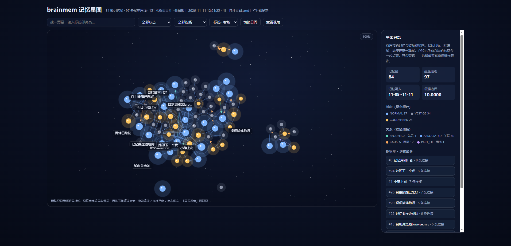
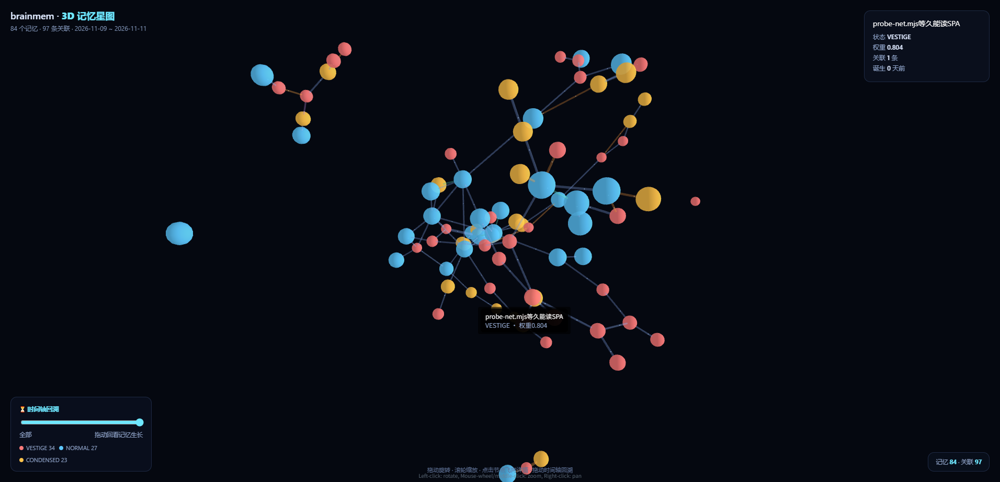

# brainmem · 仿脑记忆数据库

> 一个模拟人脑记忆规律的 AI 记忆库：**记忆会忘记、常用的会记牢、彼此会联想**。
> 一次从零的设计尝试 —— 没有参考现成方案，纯粹从"一个 AI 该怎么记事"出发。


*2D 力导向星图：节点=记忆，连线=关联，颜色=记忆状态*


*3D 记忆星图：可旋转、可缩放、时间轴回溯*

---

## ✨ 核心设计：越短越难忘

整个记忆库只围绕一个朴素直觉：**一条记忆压得越短，它就越难忘。**

| 字数 | 初始权重 |
|---|---|
| 1 字 | 8.00 |
| 3 字 | 6.00 |
| 5 字 | 5.00 |
| 8 字 | 3.00 |
| 10 字 | 1.00 |
| 20 字 | 0.81 |
| 50 字 | 0.62 |

所以每条记忆都要被压到 10 字以内 —— **细节丢给日志，记忆里只留"内核"。**

### 五条机制

- **原子化**：一句话一条，越短越重。一条只装一个可回忆的事实。
- **会遗忘**：权重随时间指数衰减，掉到零就自动消失。不常用的自然淡掉。
- **用进废退**：每次被检索到就加重；检索走过的"连接"也加重。多回忆 = 多记牢。
- **会联想**：记忆之间能建边（因果 / 先后 / 从属 / 关联），查一件事能顺着一串拉出来。
- **AI 自维护**：拆分、简写、建边，全由 AI 自己干，不用人手动整理。

> 核心体会：**简单不等于简陋。** 一套记忆规则如果复杂到每次都要人操心，它迟早会被丢下；把核心压成一句话、让 AI 自己就能执行，它反而能一直跑下去。

---

## 📦 功能

- **存储**：SQLite（默认）/ PostgreSQL 双后端
- **接口**：Python API + CLI + **MCP Server**（可直接接入各类 AI Agent）
- **可视化**：
  - `--view 2d` 力导向星空（自包含 HTML，交互式）
  - `--view 3d` 3D 记忆星图（WebGL，可旋转 / 时间轴回溯）
- **权重体系**：衰减、强化、合并、生命周期（FULL / NORMAL / CONDENSED / VESTIGE / DELETED）
- **测试**：单元 / 集成 / 属性测试 100+ 项

---

## 🚀 快速开始

```bash
cd app
pip install -e .            # 或 pip install -e ".[postgres,graph,dev]"
```

### 用 CLI

```bash
# 写入记忆（示例，见 app/demo.py）
python -m brainmem.interfaces.cli --help

# 导出 2D 星图
python -m brainmem.interfaces.cli graph --out star2d.html --view 2d

# 导出 3D 星图
python -m brainmem.interfaces.cli graph --out star3d.html --view 3d
```

### 作为 MCP Server 接入 AI

见 `app/src/brainmem/interfaces/mcp_server.py`，把 `brainmem_ingest` / `brainmem_search` 等工具挂到你的 Agent 上。

---

## 🗂 目录

```
app/
├── src/brainmem/
│   ├── core/          # 权重、衰减、边、生命周期、模型
│   ├── engine/        # 记忆引擎（写入/检索/合并/整合）
│   ├── storage/       # SQLite / PostgreSQL 后端
│   ├── services/      # 压缩、相似度、图、实体…
│   ├── interfaces/    # CLI / MCP / 可视化（2d、3d）
│   └── jobs/          # 日常扫描、夜间整合
├── tests/             # 单元 / 集成 / 属性测试
└── docs/              # 预览图
```

---

## 🧭 设计边界（诚实清单）

它不是完美的，也还在长。已知的取舍：

- **"越短越难忘"是拿细节换强度**：适合记住"内核"，但精确回忆（某本书放哪了）不如直接翻原文。
- **会真删**：权重清零就消失，不做"永不删除只标失效"。
- **暂无来源区分**：不区分"对方说的 / AI 推测的"，这是下一步想补的。
- **单机优先**：为个人 AI 助手设计，不是多租户云服务。

---

## 📄 License

MIT
